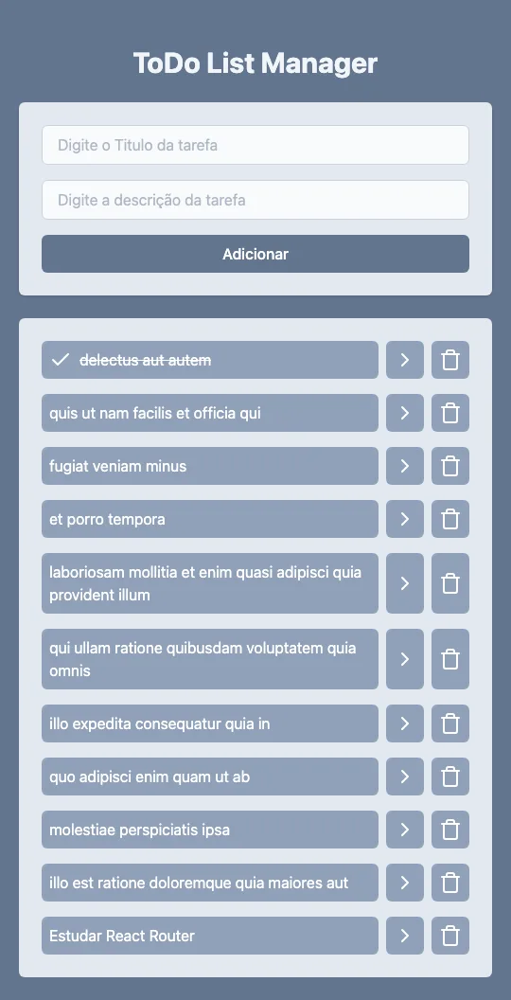
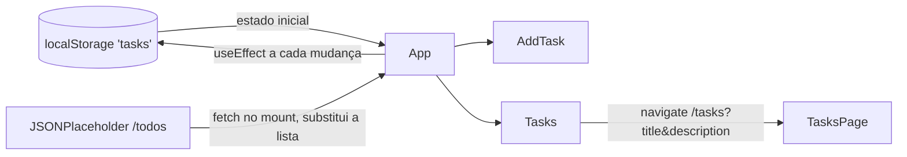

# React-Bootcamp — ToDo List Manager

Gerenciador de tarefas feito no bootcamp de React para praticar o framework: componentes, estado, efeitos, rotas e Tailwind CSS.



## Funcionalidades

- Adicionar tarefa com título e descrição (os dois são obrigatórios; senão aparece um `alert`).
- Marcar/desmarcar como concluída clicando na tarefa (risca o texto e mostra um ✓).
- Ver detalhes: o botão `>` abre `/tasks?title=...&description=...`.
- Excluir tarefa.
- Persistência em `localStorage` (chave `tasks`).
- Ao abrir, carrega 10 tarefas de exemplo da API pública [JSONPlaceholder](https://jsonplaceholder.typicode.com/todos?_limit=10).


## Como funciona



- `App.tsx` guarda a lista em `useState` e grava no `localStorage` sempre que ela muda.
- Novas tarefas recebem `id` via `uuid` (`v4`).
- `main.tsx` define as rotas com `createBrowserRouter`: `/` (lista) e `/tasks` (detalhe, lê a query com `useSearchParams`).
- `Input` e `Button` são componentes reutilizáveis com classes Tailwind.

## Stack

React 19, TypeScript 5.9, Vite 7, Tailwind CSS 4 (`@tailwindcss/vite`), React Router 7, lucide-react (ícones), uuid.

## Como rodar

Pré-requisito: Node.js 20.19+ (o repositório usa `bun.lock`; npm também funciona).

```bash
bun install        # ou: npm install
bun run dev        # http://localhost:5173
bun run build
bun run lint
```

Precisa de internet para buscar as tarefas de exemplo.

## Estrutura

```
src/
├── main.tsx              # rotas
├── App.tsx               # estado, localStorage, fetch
├── index.css             # @import "tailwindcss"
├── components/
│   ├── AddTask.tsx
│   ├── Tasks.tsx
│   ├── Title.tsx
│   ├── Input.tsx
│   └── Button.tsx
└── pages/
    └── TaskPage.tsx      # TasksPage (detalhe)
TAILWIND_EXAMPLES.md      # cola de classes Tailwind usadas no estudo
```

## Limitações conhecidas

- **As tarefas salvas somem ao recarregar.** O `useEffect` de montagem faz `setTasks(data)` com o resultado do JSONPlaceholder, substituindo a lista vinda do `localStorage`; o efeito de persistência então grava a lista da API por cima.
- As tarefas importadas usam o campo `completed` da API, mas o app lê `isCompleted`; tarefas que já vêm concluídas aparecem como abertas.
- As tarefas importadas não têm `description`, então a página de detalhe mostra "undefined".
- `npm run lint` acusa 4 erros já existentes: três `no-explicit-any` (`App.tsx`, `Button.tsx`, `Input.tsx`) e um erro de parsing em `tailwind.config.cjs` (CommonJS analisado como módulo ES).
- O script `tailwind:init` não funciona com Tailwind 4: `node_modules/tailwindcss/dist/cli.cjs` não existe mais (a CLI virou o pacote `@tailwindcss/cli`, e a v4 dispensa `tailwind.config`).
- Não há testes automatizados.
